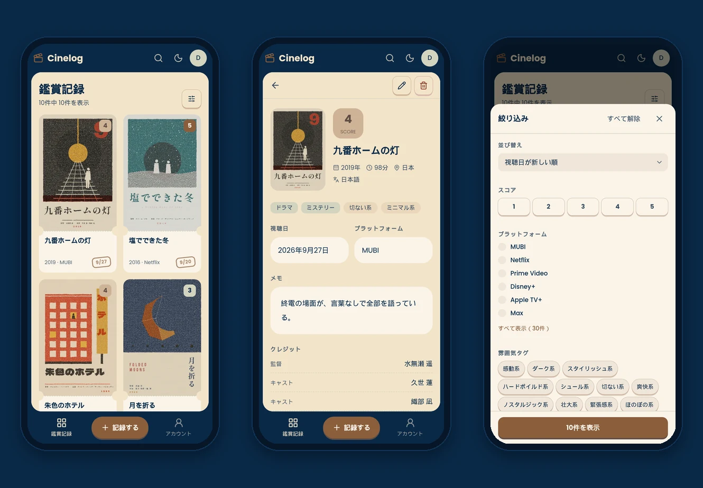
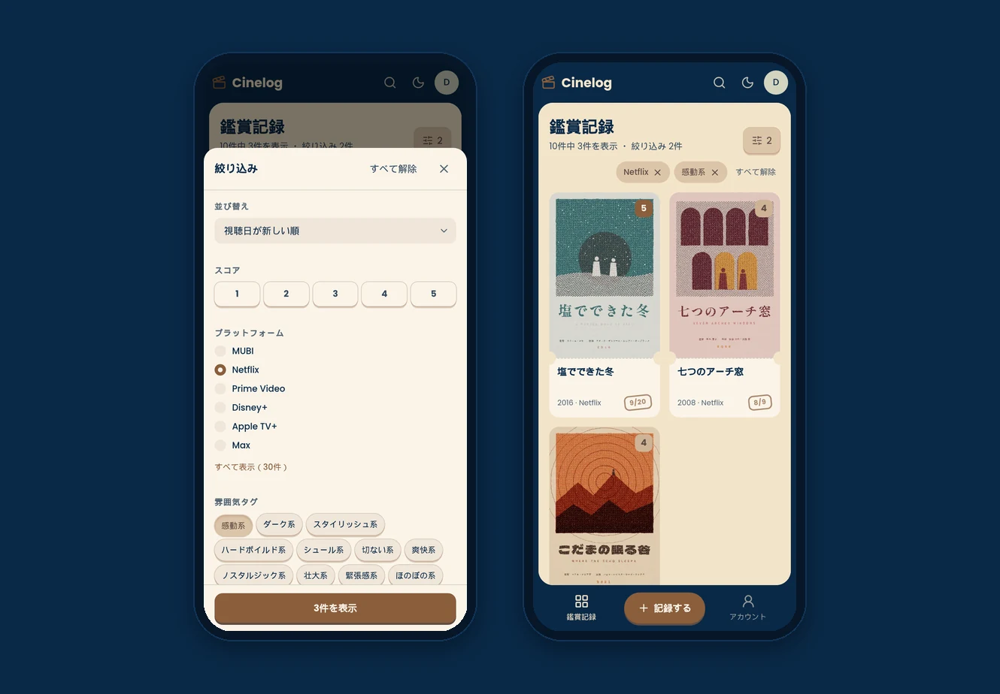
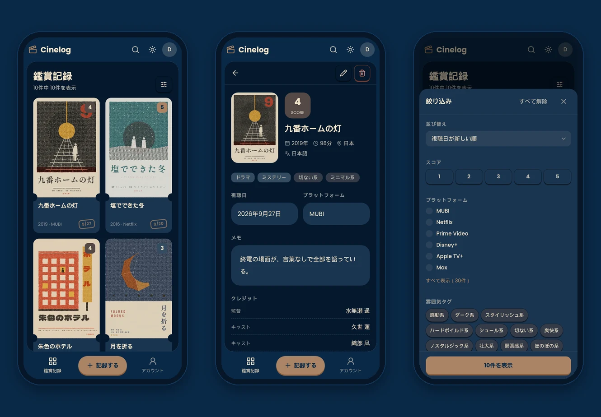
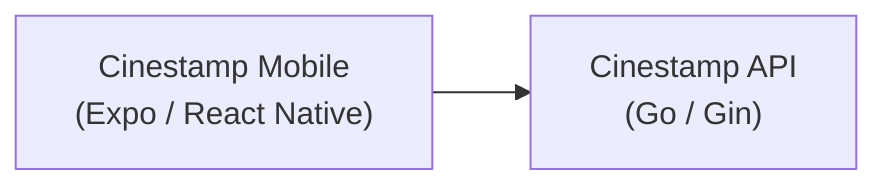

<div align="center">

# Cinestamp

[English](README.md) | **日本語**

映画鑑賞記録アプリ「Cinestamp」のモバイルアプリです。<br/>観た映画ごとに、ポスター、鑑賞日、スコア、気分、メモを記録できます。




</div>

本リポジトリでは、Cinestamp のモバイルアプリを管理しています。データの取得と保存には [Cinestamp API](https://github.com/masaya-nishimura-09/movie-log-api) を利用し、モックデータを使えば API なしでも動作します。[Web アプリ](https://github.com/masaya-nishimura-09/movie-log)もあります。

## 概要

記録にはプラットフォームと気分が残るため、観た映画をこれらの条件で絞り込めます。「Netflix で観られる、感動する映画はない？」と聞かれたときも、すぐに答えを見つけられます。

<p align="center">
  
</p>

<p align="center">
  
</p>

## アーキテクチャ



アプリから API へは直接アクセスします。アクセストークンとリフレッシュトークンは端末の安全な保存領域（iOS はキーチェーン、Android はキーストア）に保存し、アクセストークンの期限が切れたときは自動で更新します。

UI コンポーネントは、atoms、molecules、organisms の 3 層に分けています。

## 主な機能

**鑑賞記録**

- 鑑賞記録の作成・表示・更新・削除
- TMDB を利用した映画情報（公開年、上映時間、言語、制作国、ジャンル、クレジット、ポスター）の入力
- 写真ライブラリからのポスター画像のアップロード
- カレンダーによる鑑賞日の選択（「今日」「昨日」の入力にも対応）

**記録の検索**

- タイトル検索、並び替え、ページ送り
- スコア、プラットフォーム、気分、ジャンルによる絞り込み
  （スコアとプラットフォームは 1 つだけ。気分とジャンルは、選んだものをすべて持つ記録だけを表示）
- 一覧や記録の画面を下に引っ張って再読み込み

**アカウント**

- ユーザー登録、ログイン、ログアウト（トークンは自動で更新）
- アカウント情報の更新と削除

**画面**

- 日本語と英語に対応（端末の言語で切り替え）
- ライトテーマとダークテーマに対応（端末の設定に従い、画面上部のボタンで切り替え可能）
- API なしで動作するモックモード

## デザイン

画面は 4 色でつくり、赤はエラーと削除にだけ使っています。デザインは Web アプリと共通です。


ほかの色は、すべて `global.css` に、この 4 色を混ぜて作った値として定義しています。文字の太さは役割で使い分けており、本文は 400、押せる要素は 500、見出し・主要なボタン・スコアは 700 です。

## 技術スタック

| 分類             | 使用技術                                        |
|------------------|-------------------------------------------------|
| フレームワーク   | Expo（SDK 57）、React Native、Expo Router       |
| 言語             | TypeScript                                      |
| スタイル         | NativeWind（Tailwind CSS 3）、Lucide            |
| データ取得       | TanStack Query                                  |
| バリデーション   | Zod                                             |
| 保存             | Expo SecureStore（トークン）、AsyncStorage（テーマ） |
| 開発ツール       | Biome、pnpm                                     |

## セットアップ

### 前提条件

- Node.js 22.13 以上
- pnpm
- スマホの Expo Go
- [Cinestamp API](https://github.com/masaya-nishimura-09/movie-log-api)（モックモードでは不要）

### インストール

```bash
git clone https://github.com/masaya-nishimura-09/movie-log-mobile.git
cd movie-log-mobile
pnpm install
cp .env.example .env.local
# .env.local を編集し、各環境変数を設定する
pnpm start
```

スマホのカメラで QR コードを読み取り、Expo Go で開きます。CLI（`npx expo login`）と Expo Go で、同じ Expo アカウントにログインしてください。

### モックモード

`EXPO_PUBLIC_USE_MOCK=true` を設定すると、API を使わずにモックデータで動作します。メールアドレス `demo@example.com`、パスワード `password` でログインできます。モックデータはメモリ上に保持され、アプリを再読み込みすると初期状態に戻ります。モックデータの言語は、端末の言語に従います。`EXPO_PUBLIC_MOCK_DATASET=demo` を設定すると、スクリーンショットのように架空のデモ映画を使用します。

### 環境変数

`.env.local` に次の環境変数を設定してください。変更したあとは、`pnpm start` を再起動します。

| 変数                       | 必須/任意 | 説明                                                                                   |
|----------------------------|-----------|----------------------------------------------------------------------------------------|
| `EXPO_PUBLIC_API_BASE_URL` | 必須      | Cinestamp API のベース URL。`localhost` ではなく、パソコンの LAN アドレスを指定（モックモードでは不要） |
| `EXPO_PUBLIC_USE_MOCK`     | 任意      | `true` にすると、API の代わりにモックデータを使用                                      |
| `EXPO_PUBLIC_MOCK_DATASET` | 任意      | `demo` にすると、モックモードで架空のデモ映画を使用                                    |

### スクリプト

| コマンド         | 説明                               |
|------------------|------------------------------------|
| `pnpm start`     | 開発サーバーの起動                 |
| `pnpm android`   | Android 向けに開発サーバーを起動   |
| `pnpm ios`       | iOS 向けに開発サーバーを起動       |
| `pnpm web`       | Web 向けに開発サーバーを起動       |
| `pnpm lint`      | Biome によるチェック               |
| `pnpm fix`       | lint の指摘の自動修正              |
| `pnpm format`    | Biome による整形                   |
| `pnpm typecheck` | TypeScript の型チェック            |

## ディレクトリ構成

```
src/
  app/          # ルーティング（(auth)、(app)、(legal)）
  actions/      # 画面から呼び出すユースケース
  api/          # API クライアント、モックデータ
  components/   # UI コンポーネント（atoms、molecules、organisms）
  hooks/        # React フック（クエリ、フォームの状態、セッション）
  schemas/      # Zod スキーマ
  i18n/         # 言語設定、辞書
  lib/          # 補助関数（auth、date、legal、query、record、style、text、theme、url）
assets/         # アプリのアイコン、デモ用のポスター
global.css      # 色の定義
```

## 画面

| パス              | 内容               | ログイン |
|-------------------|--------------------|----------|
| /login            | ログイン           | 不要     |
| /register         | ユーザー登録       | 不要     |
| /about            | このアプリについて | 不要     |
| /terms            | 利用規約           | 不要     |
| /privacy          | プライバシーポリシー | 不要   |
| /records          | 鑑賞記録の一覧     | 必要     |
| /new              | 鑑賞記録の作成     | 必要     |
| /records/:id      | 鑑賞記録の詳細     | 必要     |
| /records/:id/edit | 鑑賞記録の編集     | 必要     |
| /account          | アカウント設定     | 必要     |

## クレジット

本アプリケーションは TMDB および TMDB API を使用していますが、TMDB による推奨、認定、その他の承認を受けたものではありません。
