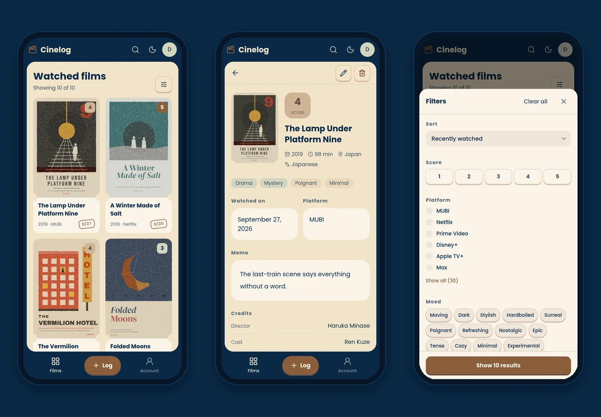
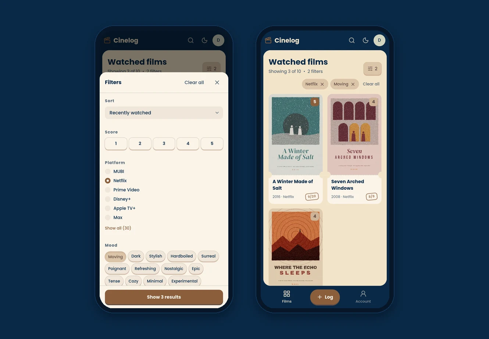
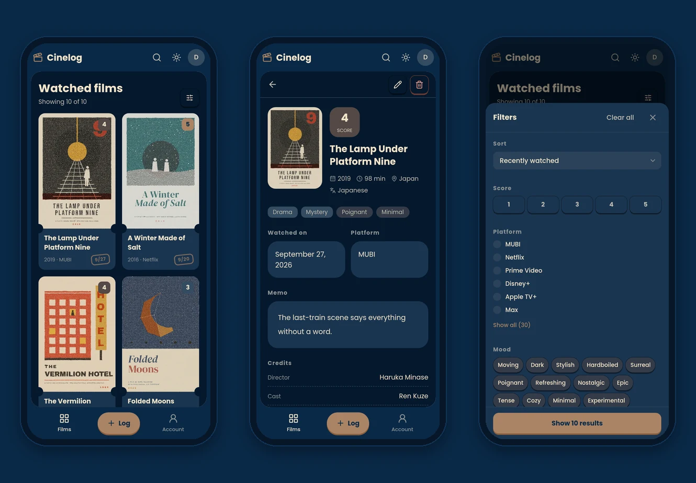
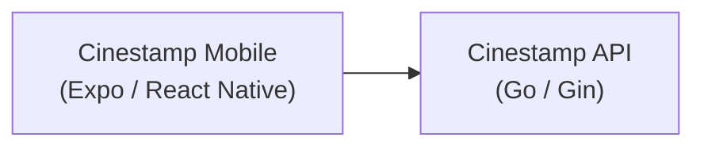

<div align="center">

# Cinestamp

**English** | [日本語](README.ja.md)

The mobile app of Cinestamp, an app for keeping a record of the films you watch.<br/>Each record keeps the poster, viewing date, score, mood, and notes for a film.




</div>

This repository contains the mobile app of Cinestamp. It uses the
[Cinestamp API](https://github.com/masaya-nishimura-09/movie-log-api)
for data and can also run on its own with mock data.
A [web app](https://github.com/masaya-nishimura-09/movie-log) is also available.

## Overview

Since every record includes the platform and mood, you can filter the films
you have watched by those conditions. When someone asks
"Is there anything moving on Netflix?", you can find an answer right away.

<p align="center">
  
</p>

<p align="center">
  
</p>

## Architecture



The app calls the API directly. The access and refresh tokens are kept in
the secure storage of the device (Keychain on iOS, Keystore on Android),
and the access token is refreshed automatically when it expires.

UI components are organized into atoms, molecules, and organisms.

## Features

**Viewing records**

- Create, view, update, and delete viewing records
- Film details (release year, runtime, language, countries, genres, credits, and poster) filled in from TMDB
- Poster image uploads from the photo library
- Viewing date selection from a calendar, with shortcuts for today and yesterday

**Finding records**

- Title search, sorting, and pagination
- Filtering by score, platform, mood, and genre
  (one score and one platform; moods and genres match only records that have all of them)
- Pull down on the list or a record to reload it

**Accounts**

- Registration, login, and logout, with automatic token refresh
- Account updates and deletion

**Interface**

- Japanese and English, chosen from the device language
- Light and dark themes, which follow the device and can be switched from the top bar
- A mock mode that runs without the API

## Design

The interface is built from four colors, with red reserved for errors and deletion.
It shares its design with the web app.


All other colors are defined in `global.css` as values mixed from these four.
Font weights depend on the role of the text: 400 for body text,
500 for anything that can be pressed, and 700 for headings, primary buttons, and scores.

## Tech Stack

| Category        | Technologies                                    |
|-----------------|-------------------------------------------------|
| Framework       | Expo (SDK 57), React Native, Expo Router        |
| Language        | TypeScript                                      |
| Styling         | NativeWind (Tailwind CSS 3), Lucide             |
| Data fetching   | TanStack Query                                  |
| Validation      | Zod                                             |
| Storage         | Expo SecureStore (tokens), AsyncStorage (theme) |
| Testing         | Vitest                                          |
| Tooling         | Biome, pnpm                                     |

## Setup

### Prerequisites

- Node.js 22.13 or later
- pnpm
- Expo Go on your phone
- [Cinestamp API](https://github.com/masaya-nishimura-09/movie-log-api)
  (not required in mock mode)

### Installation

```bash
git clone https://github.com/masaya-nishimura-09/movie-log-mobile.git
cd movie-log-mobile
pnpm install
cp .env.example .env.local
# Edit .env.local and set each environment variable
pnpm start
```

Scan the QR code with the phone camera and open it in Expo Go.
Sign in to the same Expo account on the CLI (`npx expo login`) and in Expo Go.

### Mock Mode

When `EXPO_PUBLIC_USE_MOCK=true`, the app runs on mock data without the API.
Log in with `demo@example.com` and the password `password`.
Mock data is kept in memory and resets when the app is reloaded.
The mock records follow the device language.
Set `EXPO_PUBLIC_MOCK_DATASET=demo` to use fictional demo films, as in the screenshots.

### Environment Variables

Set the following environment variables in `.env.local`,
and restart `pnpm start` after changing them.

| Variable                   | Required | Description                                                                          |
|----------------------------|----------|--------------------------------------------------------------------------------------|
| `EXPO_PUBLIC_API_BASE_URL` | Required | Base URL of the Cinestamp API, using the LAN address of your computer instead of `localhost` (not required in mock mode) |
| `EXPO_PUBLIC_USE_MOCK`     | Optional | Set to `true` to use mock data instead of the API                                    |
| `EXPO_PUBLIC_MOCK_DATASET` | Optional | Set to `demo` to use the fictional demo films in mock mode                           |

### Scripts

| Command           | Description                                  |
|-------------------|----------------------------------------------|
| `pnpm start`      | Start the development server                 |
| `pnpm android`    | Start the development server for Android     |
| `pnpm ios`        | Start the development server for iOS         |
| `pnpm web`        | Start the development server for the web     |
| `pnpm lint`       | Check the code with Biome                    |
| `pnpm fix`        | Fix lint issues                              |
| `pnpm format`     | Format the code with Biome                   |
| `pnpm typecheck`  | Run the TypeScript type check                |
| `pnpm test`       | Run the tests with Vitest                    |
| `pnpm test:watch` | Run the tests and rerun them on file changes |

Unit tests sit next to the file they test as `*.test.ts` (for example, `src/lib/url/build-href.test.ts`). Native modules are replaced with stubs in `src/test/`.

## Project Structure

```
src/
  app/          # Routes ((auth), (app), (legal))
  actions/      # Use cases called from screens
  api/          # API clients and mock data
  components/   # UI components (atoms, molecules, organisms)
  hooks/        # React hooks (queries, form state, session)
  schemas/      # Zod schemas
  i18n/         # Locales and dictionaries
  lib/          # Helpers (auth, date, legal, query, record, style, text, theme, url)
assets/         # App icons and demo posters
global.css      # Color tokens
```

## Screens

| Path              | Description      | Login        |
|-------------------|------------------|--------------|
| /login            | Login            | Not required |
| /register         | Registration     | Not required |
| /about            | About the app    | Not required |
| /terms            | Terms of use     | Not required |
| /privacy          | Privacy policy   | Not required |
| /records          | Record list      | Required     |
| /new              | New record       | Required     |
| /records/:id      | Record details   | Required     |
| /records/:id/edit | Record editing   | Required     |
| /account          | Account settings | Required     |

## Credits

This application uses TMDB and the TMDB APIs but is not endorsed,
certified, or otherwise approved by TMDB.
